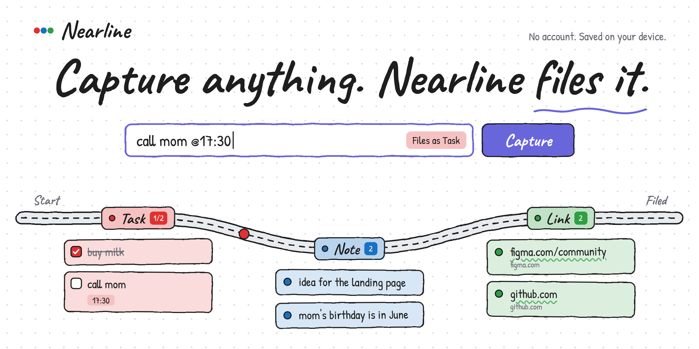

<p align="center">
  
</p>

<p align="center">
  <b>Type anything. Nearline files it.</b><br>
  A quick-capture app that sorts what you type into tasks, notes and links, and reminds you when something is due.
</p>

<p align="center">
  <a href="https://YOUR-USERNAME.github.io/nearline/"><b>Live demo</b></a> ·
  <a href="#quick-start">Quick start</a> ·
  <a href="#roadmap">Roadmap</a>
</p>

<p align="center">
  
  
  
  
</p>

---

## Contents

- [Why Nearline](#why-nearline)
- [Features](#features)
- [Quick start](#quick-start)
- [How to use it](#how-to-use-it)
- [How it works](#how-it-works)
- [Privacy](#privacy)
- [Troubleshooting](#troubleshooting)
- [Roadmap](#roadmap)
- [Contributing](#contributing)
- [Credits](#credits)
- [License](#license)

## Why Nearline

Capturing a passing thought should take seconds. In most apps you first have to decide where it goes: which app, which list, which note. By the time you decide, the thought has moved on, so people end up dumping everything into their phone's notes app.

Nearline removes that step. You type, press Enter, and it files the entry for you:

- `buy milk` becomes a **task**
- `!idea for the landing page` becomes a **note**
- `https://github.com` becomes a **link**

You can get in and back to what you were doing in a few seconds, without touching the mouse.

## Features

- **One input, no menus.** Press `/` anywhere to jump to the capture bar, type, and press Enter.
- **Auto-sorting with a live preview.** A small tag in the bar shows where your text will land before you commit it.
- **Click a stop to choose.** Each stop on the road (Task, Note, Link) opens its own input, so you can override the sorting when you want to.
- **Reminders.** Add `@17:30` to any entry. At that time a card appears with **Done** and **Snooze 10 min**, plus a system notification if the tab is in the background.
- **Tasks you can finish.** Checkboxes, strikethrough, and a done/total count on the Task stop.
- **A roadmap, not a list.** A winding road connects the three stops, and every new entry drives along it to its stop.
- **Private by design.** No account, no server. Everything is saved in your browser.
- **Accessible details.** Keyboard-friendly controls, visible focus states, reduced-motion support, and a dark theme that follows your system.
- **Hand-drawn look,** inspired by Excalidraw.

## Demo

**Try it:** [wissamn19.github.io/nearline](https://YOUR-USERNAME.github.io/nearline/)

<!-- Add a short screen recording here, for example:

-->

## Quick start

Nearline has no dependencies and no build step.

```bash
git clone https://github.com/YOUR-USERNAME/nearline.git
cd nearline
```

Then open `index.html` in your browser. If you use VS Code, the **Live Server** extension gives you auto-reload while you edit.

**Test a reminder:** type `test @HH:MM` with a time a minute or two ahead, allow notifications when the browser asks, and keep the tab open.

## How to use it

### What you type

| You type | It becomes |
| --- | --- |
| `buy milk` | Task |
| `!idea for the landing page` | Note (the `!` is removed) |
| `https://github.com` or `www.example.com` | Link |
| `call mom @17:30` | Task with a reminder at 17:30 (tomorrow, if 17:30 has already passed today) |
| Text typed into a stop's own input | Goes straight to that stop, no sorting |

A reminder time uses 24-hour `@HH:MM` and works on any type of entry. The `@17:30` part is removed from the saved text.

### Shortcuts and controls

| Action | How |
| --- | --- |
| Jump to the capture bar | `/` |
| Capture | `Enter`, or the **Capture** button |
| Capture into a specific stop | Click the stop, type, `Enter` (stays open for more) |
| Close a stop's input | `Esc` |
| Mark a task done | Tick its checkbox |
| Delete an entry | The `×` on the card |

## How it works

```
 type ──► classify ──► create item ──► save ──► render ──► drive to stop
            │
            └─ rules: URL → link, "!" → note, otherwise → task
                      (clicking a stop skips this step)
```

Every entry is stored as a small object:

```json
{
  "id": 1760980000000.42,
  "text": "call mom",
  "type": "task",
  "status": "todo",
  "createdAt": 1760980000000,
  "remindAt": 1761000600000,
  "reminded": false
}
```

- `type` is `task`, `note` or `link`. `status` is `todo` or `done`.
- `remindAt` is a timestamp, or `null` when there is no reminder.
- A timer checks for due reminders every 30 seconds, and once when the page opens. `reminded` makes sure each reminder fires only once.
- The whole list is saved to `localStorage` under the key `items` after every change.

### Project structure

```
nearline/
├── index.html      Page structure and the SVG road
├── style.css       Design tokens, layout, hand-drawn styling, dark theme
├── script.js       Classifying, rendering, storage, reminders, animations
├── docs/
│   └── cover.png
├── LICENSE
└── README.md
```

### Built with

HTML, CSS (custom properties, grid, `color-mix`), and plain JavaScript. It uses SVG paths and filters, the Web Animations API, `localStorage`, and the Notification API. There are no frameworks, libraries or build tools.

It targets current versions of Chrome, Edge, Firefox and Safari.

## Privacy

Nearline has no accounts, no analytics, and no server. Your entries are saved in your browser's `localStorage` on your device and are never sent anywhere. The only network request the page makes is for the two fonts from Google Fonts.

Clearing your browser's site data for the page deletes your entries.

## Troubleshooting

**My reminder didn't fire.**
Reminders only fire while the page is open in a browser tab. Check that you used 24-hour `@HH:MM` and that the time is in the future. If the time has already passed today, it is set for tomorrow.

**I don't get system notifications.**
Allow notifications for the site when asked. If you blocked them by accident, reset it from the lock icon in the address bar, under site settings. Do Not Disturb or Focus modes on your system can also hide notifications. The in-app reminder card appears either way.

**My entries disappeared.**
They are tied to one browser on one device. A different browser, a private window, or cleared site data starts empty.

## Roadmap

- [x] Capture, auto-sort and save locally
- [x] Task checkboxes and delete
- [x] Reminders with an in-app card and system notifications
- [x] Roadmap layout with an animated road
- [ ] "Move to..." action to correct a wrong sort
- [ ] Export your entries as JSON
- [ ] A small trained text classifier to tell tasks from notes
- [ ] Rebuild in React
- [ ] Desktop app with Tauri: a floating, always-on-top panel, with reminders that work while the app is closed

Ideas and bugs are tracked in [Issues](https://github.com/YOUR-USERNAME/nearline/issues).

## Contributing

Contributions are welcome. For anything bigger than a small fix, please open an issue first so we can agree on the direction.

1. Fork the repo and create a branch: `git checkout -b my-change`
2. Make your change and try it in the browser
3. Commit with a clear message, for example `fix: keep snoozed reminders after refresh`
4. Open a pull request describing what changed and why

## Credits

- Visual style inspired by [Excalidraw](https://github.com/excalidraw/excalidraw)
- Fonts: [Caveat](https://fonts.google.com/specimen/Caveat) and [Patrick Hand](https://fonts.google.com/specimen/Patrick+Hand), both under the SIL Open Font License

## License

Released under the [MIT License](LICENSE).